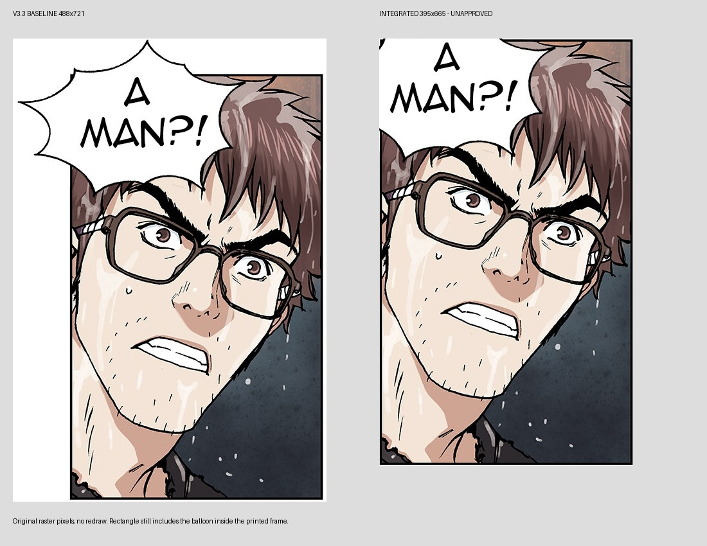
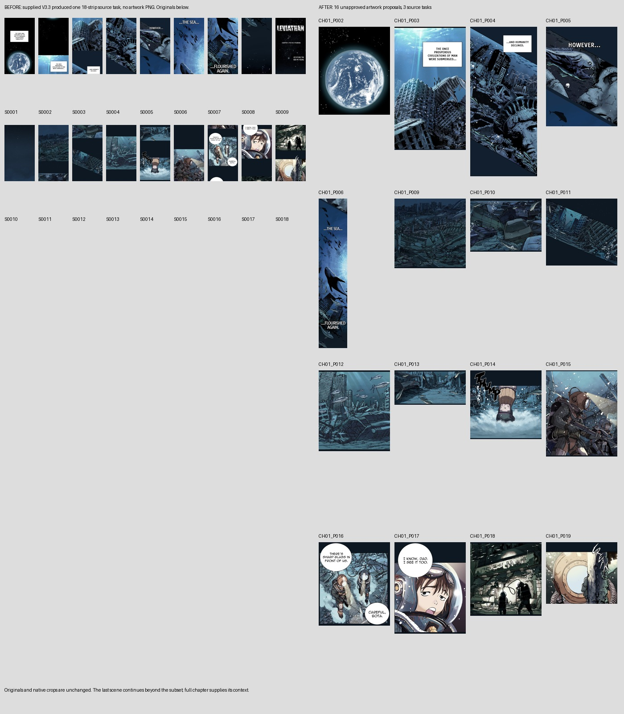

# Manga Cropping — integrated Chapter 1 build

This is the new integrated improvement of the supplied V3.3 code. **Use the downloads below.** Older development ZIPs remain in history.

- **[Download the application ZIP](https://github.com/locklockloco/Manga-/raw/refs/heads/integrated-ch01/Manga_Cropping_CH01_Integrated.zip)** — about 273 KB, source, local interface, tests and installation instructions.
- **[Download actual Chapter 1 comparisons and reports](https://github.com/locklockloco/Manga-/raw/refs/heads/integrated-ch01/CH01_Real_Results.zip)** — about 6.3 MB, original-pixel portrait crop, before/after comparisons, source maps, all overview pages and validation evidence.
- [All 213 native PNG proposals](results/unreviewed_artwork) · [Source coordinates/checksums](results/gallery_index.json) · [Full contact sheets](results/full_contact_sheets) · [Application source](app)
- **[Read the measured report and remaining failures](app/INTEGRATED_REPORT.md)** · [Changelog](app/CHANGELOG_INTEGRATED.md) · [Installation and commands](app/README.md)

On iPhone/iPad, download the ZIP to Files and extract it. The application itself runs with Python on a Windows, Mac or Linux computer; an archive preview is not the app. Transfer the original chapter strips to that computer, and use a **new output folder**. Existing workspaces and manual corrections remain intact.

## Actual source-backed results

All 194 original 690×1280 Chapter 1 JPEGs were present, ordered and checksum-verified unchanged. The full chapter was processed, its pixels checked, all final thumbnails inspected, and selected failures revisited against native source strips.

| Case | Supplied V3.3 | Integrated build |
|---|---|---|
| Opening S0001–S0018 | One giant source task, no artwork PNG | 16 unapproved artwork proposals, 3 source tasks; last scene continues beyond subset |
| Documented text negatives | 7 of the 9 cases exported as standalone PNGs | **0 of those 9 cases exports a standalone artwork PNG** |
| Cross-strip A MAN portrait | 488×721 with outside white margin | **395×665**, original character frame preserved, 25.34% less rectangular area |
| Full Chapter 1 | 162 exported proposals | 213 unapproved proposals plus 75 source-review metadata records |

**More exports do not establish accuracy.** All 213 remain unapproved. Confirmed automatic merges remain at fish displays S0067–S0068 and children/weapon scenes S0144–S0145; other compounds, margins and ambiguous content need review. Separate [assistant correction examples](results/assisted_corrections) demonstrate edits, not automatic successes. Whole-chapter panel precision/recall is **not established**. This build is **NOT READY for unattended extraction**.

The balloon overlapping inside the original printed artwork frame remains; a rectangle cannot erase it without losing artwork. Source pixels are never repainted or invented.

[Text negatives comparison](results/text_before_after_audit.png) · [All seven overview pages](results/final_overviews)

The repository suite passed 184 tests; the delivered focused run passed 10 composition/real-source checks. Dedicated 200/500 full-resolution synthetic batches, crash/recovery, checksum repair, final discovery replay and 525,841,200-pixel final encoder checks are documented separately from real manga accuracy. Final 194-source discovery reproduced every saved bounds/metadata record. Linux CLI and Chromium review were tested; native Windows/macOS startup remains untested. No automatic crop was marked VERIFIED.

The full chapter measured 359.32 seconds on the shared Linux host, with per-stage/resource details and measurement limitations in the report. These are observed timings, not a controlled speed comparison.
